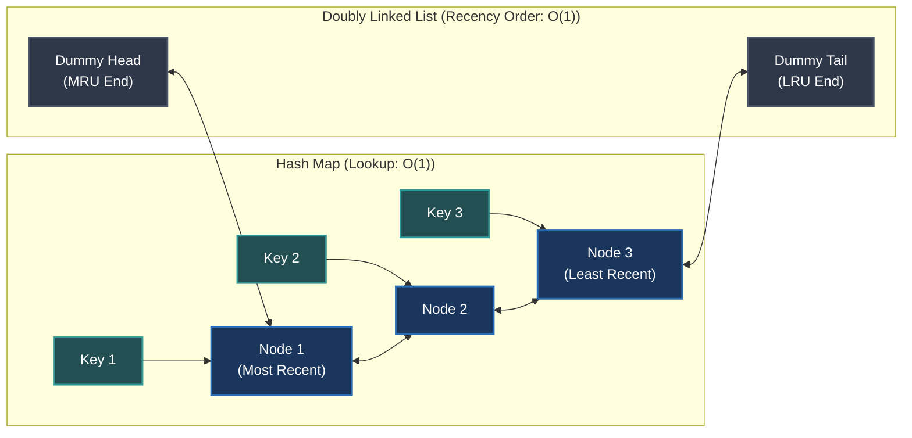

# LRU Cache

> **Topic:** Least Recently Used (LRU) Cache  
> **Key Concepts:** Hash Map + Doubly Linked List, Dummy Sentinels, Structural Invariants, Differential Testing  

---

## 1. Original Interview Question

### Problem Statement
Design and implement a **Least Recently Used (LRU)** cache with a fixed capacity.

Support these operations:
* `get(int key)`: Return the value associated with the key, or `-1` if the key does not exist.
* `put(int key, int value)`: Insert a new key-value pair or update an existing key. If inserting a new key exceeds the cache's capacity, evict the least recently used entry.

### Requirements & Constraints
* Both operations should run in average **$O(1)$** time.
* You may use a **hash map** and a **doubly linked list**.

> [!NOTE]
> **What is an LRU Cache?**  
> An LRU cache stores a limited number of entries and evicts the entry that has gone unused for the longest time when space is needed.

---

## 2. Clarifying Questions and Correct Answers

These are the questions asked at the beginning, along with the expected interviewer answers:

| Your Question | Correct Answer |
| :--- | :--- |
| **Does initialization take only capacity?** | Yes, `LRU(int capacity)`. |
| **What is the capacity constraint?** | Capacity must be positive. Reject nonpositive capacity with `IllegalArgumentException`. |
| **Which methods are required?** | `get(key)` and `put(key, value)`. |
| **Are keys and values generic?** | For this problem, both are integers. |
| **What happens when `get` misses?** | Return `-1`. |
| **What if the key already exists during `put`?** | Update its value and make it MRU; do not evict another entry. |
| **What counts as recent usage?** | A successful `get` and every `put`, including updating an existing key. |
| **What happens when inserting into a full cache?** | Evict the LRU entry before inserting the new entry. |
| **Is concurrency required?** | No. The problem specifies a single-threaded implementation. |
| **What complexity is expected?** | Average $O(1)$ time per operation and $O(C)$ space. |

> [!WARNING]
> **Subtle contract detail:** Values can be `-1`, so a miss and a stored value of `-1` are indistinguishable from the return value alone. That is acceptable under our stated API.

---

## 3. Choosing the Data Structures

The optimal standard solution combines two data structures:



### 1. Hash Map (`key` $\to$ `Node`)
Finds the node associated with a key in average **$O(1)$** time, avoiding the need to scan the linked list.

### 2. Doubly Linked List
Maintains the recency order. Given a direct `Node` reference, you can remove it and move it to the front in **$O(1)$** time.

```java
private static class Node {
    int key;
    int val;
    Node prev;
    Node next;
}
```

### Sentinel Nodes (Dummy Head & Tail)
Use dummy `head` and `tail` sentinels so every real node always has a predecessor and successor:
* `head.next` is the **MRU** (Most Recently Used) entry.
* `tail.prev` is the **LRU** (Least Recently Used) entry.
* An empty list satisfies: `head.next == tail` and `tail.prev == head`.

*This eliminates special-case branching during pointer manipulation.*

### Why Not Use Only One Data Structure?
* **Hash map alone:** Fast lookup ($O(1)$), but cannot track or maintain access order.
* **Plain queue:** Maintains order, but moving an arbitrary accessed entry to the front is not $O(1)$ ($O(N)$ lookup/removal).
* **Singly linked list:** Lacks direct access to a node's predecessor, making arbitrary node removal $O(N)$ unless scanned.
* **Doubly linked list + Hash map:** Combines $O(1)$ random access by key with $O(1)$ arbitrary node detachment and insertion.

---

## 4. Complete Java Implementation

This is a polished version of the solution, keeping the design arrived at independently:

```java
package StatefulSimulations.Caching;

import java.util.HashMap;
import java.util.Map;

public class LRU {

    private static class Node {
        int key;
        int val;
        Node prev;
        Node next;

        Node(int key, int val) {
            this.key = key;
            this.val = val;
        }
    }

    private final Node head;
    private final Node tail;
    private final int cap;
    private final Map<Integer, Node> map;

    public LRU(int cap) {
        if (cap <= 0) {
            throw new IllegalArgumentException(
                "Capacity must be positive"
            );
        }

        this.cap = cap;
        this.map = new HashMap<>();

        this.head = new Node(0, 0);
        this.tail = new Node(0, 0);

        head.next = tail;
        tail.prev = head;
    }

    public int get(int key) {
        Node node = map.get(key);

        if (node == null) {
            return -1;
        }

        remove(node);
        insertAtHead(node);

        return node.val;
    }

    public void put(int key, int val) {
        Node node = map.get(key);

        // Update an existing entry.
        if (node != null) {
            node.val = val;
            remove(node);
            insertAtHead(node);
            return;
        }

        // Evict the least recently used entry if full.
        if (map.size() == cap) {
            Node lru = tail.prev;
            remove(lru);
            map.remove(lru.key);
        }

        // Insert a new entry.
        Node newNode = new Node(key, val);
        map.put(key, newNode);
        insertAtHead(newNode);
    }

    private void remove(Node node) {
        node.prev.next = node.next;
        node.next.prev = node.prev;
    }

    private void insertAtHead(Node node) {
        node.next = head.next;
        node.prev = head;

        head.next.prev = node;
        head.next = node;
    }
}
```

### How the Implementation Works

#### `get(key)`
1. Look up the node in the map.
2. If absent, return `-1`.
3. Otherwise, remove the node from its current position.
4. Insert it immediately after the dummy head.
5. Return its value.  
**Time:** Average $O(1)$.

#### `put(key, value)`
1. Look up the key.
2. If it exists, update the value, move that node to the head, and return.
3. Otherwise, if the cache is full, remove `tail.prev` from both the list and the map.
4. Create the new node, add it to the map, and insert it at the head.  
**Time:** Average $O(1)$.

> [!TIP]
> **Why updating an existing key doesn't require a map update:**  
> The map already points to the existing `Node` reference. Mutating `node.val` changes the value returned through that same map reference. You only need to reposition the node in the doubly linked list.

---

## 5. The Most Important Concept: Invariants

> **Definition:** An invariant is a property that must hold at the boundaries of every completed operation.

Before writing code, ask:
1. What state do my data structures represent?
2. What must agree across the data structures?
3. What structural properties must remain true?
4. What behavioral guarantees must each operation preserve?
5. What bounds must never be violated?

### LRU Structural & Behavioral Invariants

| Invariant | What Must Be True? |
| :--- | :--- |
| **Map/List Bijection** | Each real list node has exactly one corresponding map entry, and the map points to that exact node. |
| **Pointer Integrity** | For each real node, `node.next.prev == node` and `node.prev.next == node`. |
| **Capacity Bound** | `map.size() <= cap`. |
| **Size Consistency** | The map size equals the number of real nodes in the list (`map.size() == list.size()`). |
| **Recency Order** | The head's successor (`head.next`) is MRU; the tail's predecessor (`tail.prev`) is LRU. |
| **Key Uniqueness** | A key appears at most once in the list. |

### How to Use Invariants While Coding
Before implementing an operation, write down what it changes and what must remain true:
* `get(key)` changes recency, but **must not change** the set of keys or values.
* `put(existingKey, value)` changes value and recency, but **must not change** the number of entries.
* `put(newKey, value)` may change the set of keys, but **must preserve** capacity bounds and map/list consistency.

*This gives you a rigorous way to reason about correctness instead of hoping the code works.*

---

## 6. All Technical Follow-Ups and Correct Answers

These are the follow-up questions asked during the mock interview:

### Follow-up 1: How do you maintain list ordering?
**Correct answer:** Use the head as the MRU end and the tail as the LRU end. Insert every new or accessed node immediately after the head. Evict the node immediately before the tail (`tail.prev`).

---

### Follow-up 2: How do you update recency during `get(5)`?
**Correct answer:** Find the node through the map, detach it from its current position (`remove(node)`), and insert it at the head (`insertAtHead(node)`). If it is already at the head, the remove-and-insert sequence still works correctly with this implementation.

---

### Follow-up 3: What if `put(5, 100)` finds an existing key?
**Correct answer:** Update the existing node's value (`node.val = val`), move it to the head, and return without eviction or changing the map entry. Reusing the node is simpler and cleaner than removing it and creating a new one.

---

### Follow-up 4: What if the cache is full and a new key arrives?
**Correct answer:** Remove `tail.prev`, delete its key from the map (`map.remove(lru.key)`), then allocate and insert the new node at the head. Both structures must be kept in sync.

---

### Follow-up 5: How do you handle an empty list or a list with one entry?
**Correct answer:** With sentinels, an empty list has `head.next == tail` and `tail.prev == head`. Removing the sole real node restores that exact state automatically without special-casing `null`.

---

### Follow-up 6: Should you use null-terminated ends or sentinels?
**Correct answer:** Both are valid. Sentinels simplify boundary handling because every real node always has a non-null predecessor and successor. Your original implementation used sentinels, which was an optimal choice.

---

### Follow-up 7: What happens if capacity is zero or negative?
**Correct answer:** Reject the constructor argument with an `IllegalArgumentException`, since the agreed contract requires positive capacity.

---

### Follow-up 8: What should be `final` or `private`?
**Correct answer:** 
* The `map` reference should be `final` because it is never reassigned.
* The nested `Node` class should generally be `private static`, since it doesn't need access to an outer instance.
* The `head` and `tail` references can and should also be `final`.

---

### Follow-up 9: What invariants must hold between the map and list?
**Correct answer:** The map and list must contain exactly the same real nodes, the map must point to each corresponding node, their sizes must agree, and the list must maintain valid bidirectional pointers and correct recency order.

---

### Follow-up 10: How do you detect broken pointers?
**Correct answer:** Traverse the list and verify `node.next.prev == node` and `node.prev.next == node` for each real node. Ensure forward traversal terminates at the `tail` sentinel.

---

### Follow-up 11: How do you detect cycles?
**Correct answer:** Maintain a `Set<Node>` of visited nodes. Before advancing, check whether the current node has already been visited. Alternatively, impose a traversal bound based on the expected number of nodes plus sentinels.

---

### Follow-up 12: How do you validate map/list bijection?
**Correct answer:** Traverse every real node and verify that `map.get(node.key) == node`. Count the traversed nodes and compare the count with `map.size()`. This catches missing map entries and map entries pointing to detached or mismatched nodes.

---

### Follow-up 13: How do you test randomized operations?
**Correct answer:** Use a reference LRU model, such as an access-order `LinkedHashMap` with explicit eviction logic. Generate random `get` and `put` operations, compare return values and contents after every operation, verify recency order, and run structural invariant checks. Use a fixed random seed so test failures are 100% reproducible.

---

### Follow-up 14: Why isn't comparing key-value contents enough?
**Correct answer:** Two caches can contain identical entries but maintain different recency orders. For example, with capacity 3, both might contain `A`, `B`, and `C`, but one has order `A → B → C` while the other has `C → B → A`. Inserting `D` would evict different keys. Furthermore, checking contents alone cannot detect internal structural defects, such as broken back-pointers or detached nodes.

---

## 7. Complexity Analysis

| Operation | Complexity | Reason |
| :--- | :---: | :--- |
| **`get(key)`** | Average $O(1)$ | Hash map lookup plus constant-time pointer updates |
| **`put(key, value)`** | Average $O(1)$ | Hash map lookup/insertion plus constant-time pointer updates |
| **Remove a known node** | $O(1)$ | Two neighboring pointer updates (`node.prev.next`, `node.next.prev`) |
| **Insert at head** | $O(1)$ | Four pointer assignments with dummy sentinels |
| **Evict LRU** | $O(1)$ | The LRU node is immediately accessible at `tail.prev` |
| **Total Space** | $O(C)$ | At most $C$ real nodes and $C$ map entries, where $C = \text{capacity}$ |

> [!NOTE]
> The map provides **average**, not unconditional worst-case, $O(1)$ operations because hash-table operations can degrade under hash collisions (amortized $O(1)$).

---

## 8. What Would Make Your Performance "Strong Hire"?

Your implementation was already correct for the specified requirements. The main opportunity to achieve **Strong Hire** is demonstrating **independent precision in reasoning and testing**.

Before coding a similar problem, aim to demonstrate these behaviors without prompting:
- [x] **Clarify the contract and unusual cases** up front.
- [x] **Explain why your data structures meet the complexity requirements**.
- [x] **State the invariants explicitly** before writing method logic.
- [x] **Identify the edge cases** most likely to break pointer integrity.
- [x] **Propose a reference model and differential testing strategy**.
- [x] **Explain why the implementation preserves invariants** after every completed operation.

> *The goal isn't to recite a checklist mechanically. It's to prove that you understand what makes your implementation correct and how you would systematically detect a subtle bug in production.*

---

> [!TIP]
> ### 💡 Best Way to Revise
> Close the code, reimplement the cache from memory, and narrate the invariants before you write the first line. Then test it with a sequence that repeatedly updates an existing key, accesses old entries, and forces eviction. If you can do that independently and explain why each invariant holds, you've mastered the underlying system design and reasoning—not just memorized the LRU solution.